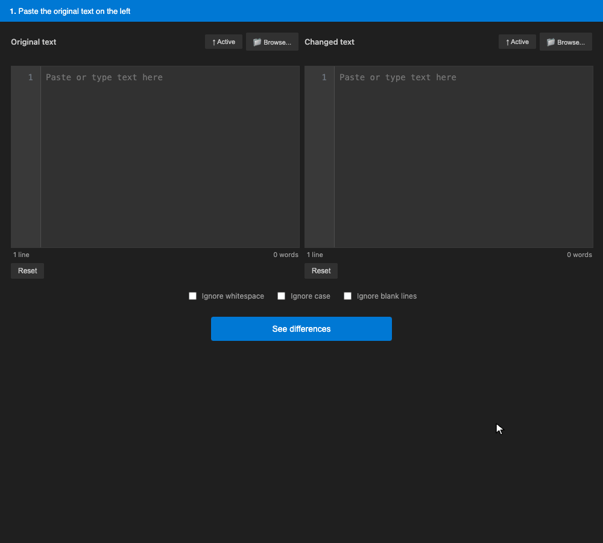
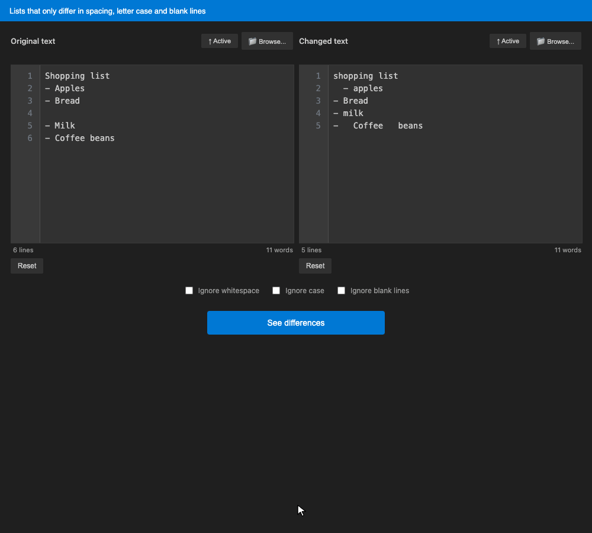
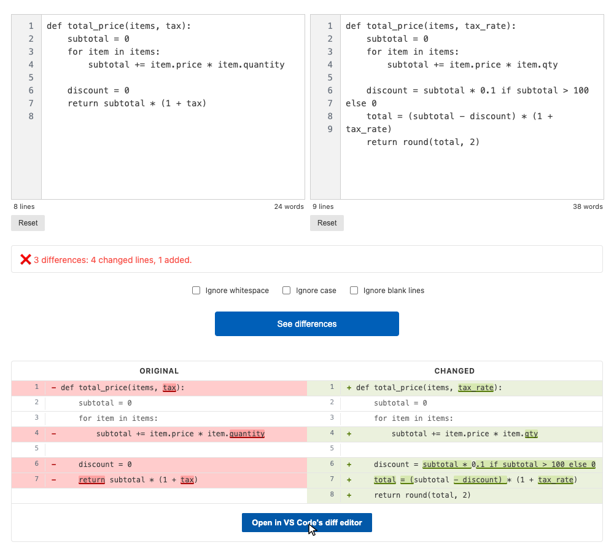

# Diff Checker

Compare two texts side by side, right inside VS Code. Changed lines face each other and only the words that changed are highlighted, in your theme's diff colours. Ignore whitespace, case or blank lines with one click, and open the result in VS Code's diff editor when you need it.

## ✨ Features

- 🔍 **Side-by-side diff**: changed lines face each other, with the changed words highlighted, like on GitHub
- 🎨 **Your theme's colours**: the panel and the highlights follow your VS Code theme, light or dark
- 🧹 **Ignore whitespace, case or blank lines**: one click, and the result updates
- 📊 **Clear summary**: how many differences, and how many lines changed, were added or removed
- 📁 **Load text from anywhere**: paste it, load the active file, browse for a file, or send the selection from the editor
- 🎯 **VS Code diff editor**: open the same comparison in VS Code's built-in diff editor with one button
- 🔢 **Line numbers, line and word counts** for each text

## 🚀 Installation

Install it from the [**VS Code Marketplace**](https://marketplace.visualstudio.com/items?itemName=MCCProgrammer.diff-checker), or from [**Open VSX**](https://open-vsx.org/extension/MCCProgrammer/diff-checker) if you use VSCodium, Cursor, Windsurf or another editor based on VS Code.

## 📖 How to Use

### Open the Diff Checker

- Right-click in any editor → **Show Diff Checker**
- Or open the Command Palette (`Cmd+Shift+P` / `Ctrl+Shift+P`) and run **Diff Checker: Show Diff Checker**

### Add the two texts

- **Paste or type** into **Original text** (left) and **Changed text** (right)
- **↑ Active** loads the file you were last editing; **📁 Browse...** picks a file from disk
- Select text in an editor, right-click → **Load Selection to Text A** or **Load Selection to Text B**
- If text is selected when you open the Diff Checker, it goes into the first empty box

### See the differences

Click **See differences**. The summary tells you how many differences there are (groups of consecutive changed lines) and how many lines changed, were added or were removed. Below it, the two texts are shown side by side:

- a **changed line** shows the old version on the left and the new one on the right, with only the changed words highlighted
- an **added line** appears on the right only, a **removed line** on the left only
- unchanged lines are shown on both sides, so you keep the context

**Open in VS Code's diff editor** opens the same comparison in the built-in diff editor.

### Ignore what doesn't matter

- **Ignore whitespace**: indentation and repeated spaces don't count
- **Ignore case**: `Apples` and `apples` are the same
- **Ignore blank lines**: added or removed empty lines don't count

The result updates as soon as you tick an option, and your choices are remembered.

### Works with every theme

## ⌨️ Keyboard Shortcut

The Diff Checker has no default shortcut, so it never takes over another one. To add yours, open **Keyboard Shortcuts** (`Cmd+K Cmd+S` / `Ctrl+K Ctrl+S`), search for "Diff Checker" and set the key you want for **Show Diff Checker**.

## 📚 Requirements

- VS Code 1.85 or later, or an editor based on it (Cursor, VSCodium, Windsurf...)

## 📝 Release Notes

See [CHANGELOG.md](CHANGELOG.md).

## 📬 Contact & Support

Questions, feedback or ideas: [contact@mccprogrammer.com](mailto:contact@mccprogrammer.com), or [open an issue](https://github.com/MCCProgrammer/diff-checker-vscode-extension/issues).

If the extension helps you, a coffee on [Ko-fi](https://ko-fi.com/mccprogrammer) makes a big difference.

## 🤝 Contributing

Contributions are welcome! Please open an issue or pull request in the repository.

## 📄 License

This project is licensed under the MIT License.

## 🙏 Acknowledgments

- [jsdiff](https://github.com/kpdecker/jsdiff) for the line and word comparison
- VS Code Extension API
